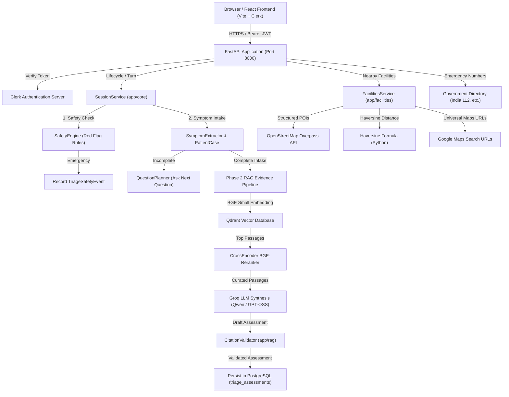
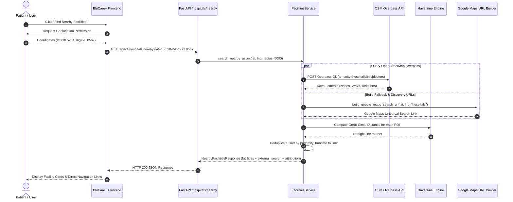
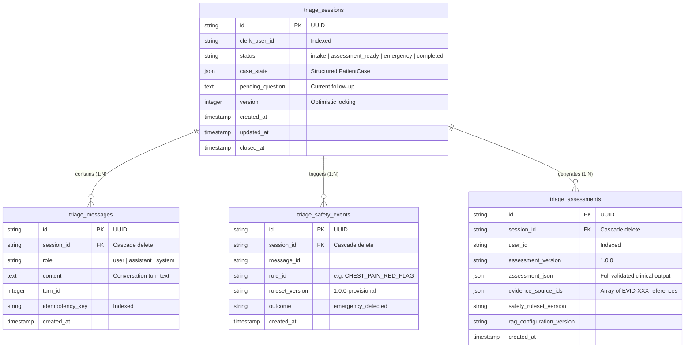

# BLUCARE+ — COMPLETE SYSTEM ARCHITECTURE
## End-to-End Technical Reference & Component Topologies

**Document Version:** 1.0.0  
**Architectural Scope:** Full Stack (Frontend, Backend, Vector Store, PostgreSQL, External Integrations)  
**Date:** 2026-11-04  

---

## 1. System Overview

BluCare+ is an AI-powered medical symptom-triage decision-support system. It provides structured symptom intake, dynamic follow-up questioning, real-time safety evaluation, evidence-grounded medical assessment retrieval with verified citations, and genuine nearby healthcare facility discovery.

---

## 2. Complete Request Lifecycle

### 2.1 Symptom Intake Turn Lifecycle
1. **User Authentication:** Client issues `POST /api/v1/session/message` with JSON `{ "thread_id": "...", "message": "..." }` and `Authorization: Bearer <clerk_jwt>`.
2. **Gateway Verification:** `get_current_user` validates token signature against cached Clerk JWKS or dev environment bypass.
3. **Session Retrieval & Ownership Check:** `TriageRepository.get_session` fetches the active `TriageSession` by `thread_id` and ensures `clerk_user_id` matches.
4. **Emergency Evaluation (Safety First):** `SafetyEngine.evaluate` inspects current user message and accumulated symptom history for acute red flags (e.g., crushing chest pain radiating to left arm). If matched:
   - Status changes to `emergency`.
   - `TriageSafetyEvent` is recorded in PostgreSQL.
   - Normal intake and RAG stop immediately. Emergency guidance and verified emergency contacts are returned.
5. **Structured Symptom Extraction:** `SymptomExtractor.extract` identifies primary symptom, duration, severity, and modifiers, updating `PatientCase` with fact provenance.
6. **Adaptive Question Planning:** If essential clinical triage dimensions (duration, severity) are unstated:
   - `QuestionPlanner.evaluate_intake` determines the single highest-priority missing dimension.
   - The question is returned to the user, and session status remains `intake`.
7. **RAG Pipeline Execution (Intake Complete):** When all required intake dimensions are satisfied:
   - `build_medical_query` generates a deterministic clinical retrieval query.
   - BGE embeddings query Qdrant; top candidates are reranked via `CrossEncoder`.
   - `assemble_medical_context` builds verified source context.
   - `EvidenceGroundedSynthesizer` generates clinical explanations with `[EVID-XXX]` citations.
   - `CitationValidator` strips any hallucinated citations, ensuring 100% citation grounding.
8. **Assessment Persistence:** `TriageRepository.save_assessment` writes the structured assessment to `triage_assessments` in PostgreSQL.
9. **API Response:** Clean, formatted triage recommendations, warning signs, and validated sources are returned.

---

## 3. Facilities Discovery Architecture

Facilities search is completely decoupled from symptom intake and clinical reasoning:

### 3.1 Graceful Degradation Matrix
| Condition | Overpass Response | API Status | Facilities List | Google Maps Link |
|---|---|---|---|---|
| Normal Operation | HTTP 200 with elements | `success` | Real OSM facilities | Populated |
| Sparse Area | HTTP 200 with 0 elements | `empty` | `[]` | Populated |
| Rate Limited (HTTP 429) | HTTP 429 | `unavailable` | `[]` | Populated |
| Overpass Timeout (>25s) | `httpx.TimeoutException` | `unavailable` | `[]` | Populated |
| No Internet / Down Server | Connection error | `unavailable` | `[]` | Populated |

**Guaranteed Invariant:** The user is never stranded with an unhandled exception or fake placeholder hospitals. Universal Google Maps search links are guaranteed whenever valid coordinates are supplied.

---

## 4. Database Schema & Relationships

---

## 5. Security & Privacy Controls

1. **Patient Data Leak Prevention:**
   - Geolocation coordinates are only accepted on explicit facility discovery requests.
   - Medical symptoms, disease hypotheses, diagnoses, patient names, and session IDs are **strictly excluded** from all external Map and Overpass queries.
2. **Authentication Isolation:**
   - Every database query in `TriageRepository` filters by `clerk_user_id == authenticated_user_id`.
   - Access to `/api/v1/assessments/{id}` and `/api/v1/sessions/{id}/assessment` enforces ownership checks; unauthorized cross-user queries return 404.
3. **SQL & Injection Resistance:**
   - SQLAlchemy parameterized queries prevent SQL injection.
   - Overpass queries use strictly validated coordinate floats and fixed category enum values; patient text is never concatenated into Overpass QL.
4. **Security Headers:**
   - Middleware enforces `X-Content-Type-Options: nosniff`, `X-Frame-Options: DENY`, `X-XSS-Protection: 1; mode=block`, and `Referrer-Policy: strict-origin-when-cross-origin`.
