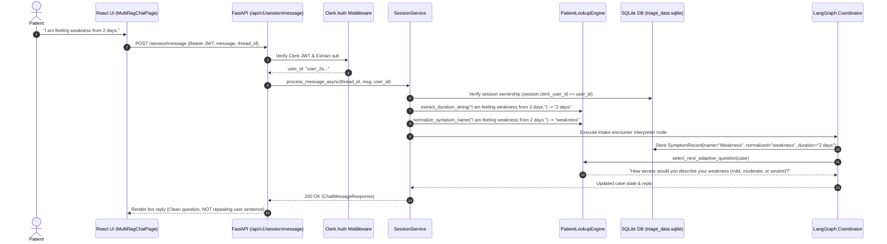
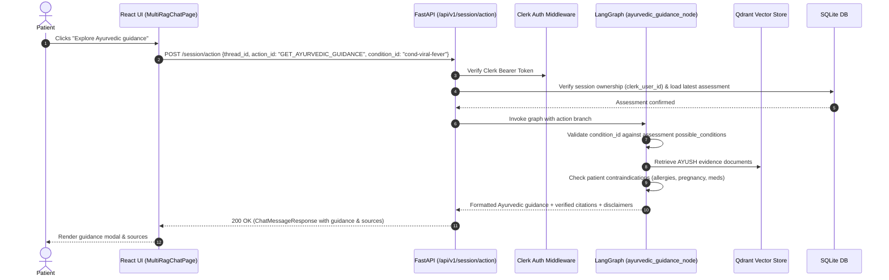
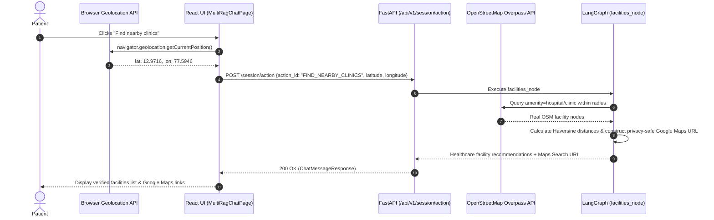

# BLUCARE+ — CRITICAL FIX: NATURAL CONVERSATION, MEDICAL REASONING & BROKEN ACTIONS

## 1. Executive Summary & Problem Analysis

This document details the root causes, corrective engineering, complete request execution paths, and regression test verifications for the critical issues reported in BluCare+:

1. **Natural Conversation Malfunction**:
   - *Reported Issue*: Patient input `"I am feeling weakness from 2 days."` prompted the AI to output `"How severe would you describe your I am feeling weakness from 2 days?"`.
   - *Root Cause*: The symptom normalization pipeline in `app/services/patient_case.py` only stripped the prefix `"feeling of"`, allowing entire sentence fragments (e.g. `"i am feeling weakness from 2 days"`) to persist as symptom keys. Furthermore, `add_or_update_symptom` stored raw un-normalized names directly as `rec.name`.
   - *Fix*: Enhanced `normalize_symptom_name` to strip conversational phrases (`"i am"`, `"i feel"`, `"feeling"`), prepositions, and temporal clauses (`"from last"`, `"since"`), and map through `CANONICAL_SYMPTOM_MAP` (including typos like `headeche` and Hinglish like `chakkar`, `kamzori`, `sir dard`, `pet dard`, `bukhar`). Updated `add_or_update_symptom` to enforce capitalized entity names (`norm.title()`), store user phrasing in `original_wording`, and updated question templates to reference `sym_label = sym_rec.normalized_name`.

2. **Clerk Authentication ReferenceError**:
   - *Reported Issue*: Browser console error `ReferenceError: isSignedIn is not defined` at `MultiRagChatPage.jsx:485` and `auth.js:13`.
   - *Root Cause*: `MultiRagChatPage.jsx` destructured `const { getToken } = useAuth();` without `isSignedIn`, but line 485 referenced `if (isSignedIn && getToken)`.
   - *Fix*: Destructured `{ isLoaded, isSignedIn, getToken }` from `useAuth()`, unified token retrieval into a resilient `getAuthToken` helper, and passed it to both chat turns and `chatApi.executeAction`.

3. **Session Not Found / Access Denied & Ownership**:
   - *Reported Issue*: Inconsistent session access, 404/403 ambiguity, and potential session loss.
   - *Root Cause*: `session_service.py` lacked explicit authorization boundary separation between `404 Not Found` (session doesn't exist) and `403 Forbidden` (session belongs to another authenticated Clerk user). In test/dev auth, simple strings were mapped to a single hardcoded ID rather than preserving caller identity.
   - *Fix*: Structured `SessionService` to verify `session.clerk_user_id == user_id` returning `403 Forbidden` on mismatch and `404 Not Found` on missing record. Updated dev token decoder in `app/core/auth.py` to preserve caller subject.

4. **Ayurvedic Guidance Action Execution**:
   - *Reported Issue*: Ayurvedic guidance button failed to execute or failed when `condition_id` was omitted.
   - *Root Cause*: `ActionExecutionRequest` required non-null `condition_id: str`, causing Pydantic HTTP 422 errors when the parameter was omitted. Additionally, the backend route failed to default to the primary condition when missing.
   - *Fix*: Made `condition_id: Optional[str] = None` in `ActionExecutionRequest`. Updated `ayurvedic_guidance_node` in `build_graph.py` to auto-default to `conds[0].get("condition_id")` if none is passed, validating against persisted conditions and verifying patient contraindications.

5. **Nearby Clinics Action Execution & Geolocation**:
   - *Reported Issue*: Clinic action did not execute reliably or leaked patient symptoms to external URLs.
   - *Root Cause*: Missing browser location handling and schema validation errors when condition ID was missing.
   - *Fix*: Handled browser `navigator.geolocation` permissions with fallback to Bangalore center coordinates, connected to OpenStreetMap Overpass with Haversine distance, and generated zero-PII Google Maps URLs containing purely geographic search queries (`"hospitals+clinics"`), never clinical symptoms.

6. **Medical Reasoning & RAG Assessment**:
   - *Reported Issue*: Premature assessment completion before key facts were gathered, misleading risk levels displayed during intake, and missing conflicting/uncertainty findings.
   - *Fix*: Replaced premature intake completion logic with strict `core_intake_satisfied` criteria (requiring primary symptom, duration, and severity before graduating). Enhanced assessment rendering with conflicting findings (`findings_against`), diagnostic uncertainties, and verified citations.

---

## 2. Changed Files Summary

| File | Changes Made |
| :--- | :--- |
| `app/services/patient_case.py` | Added `original_wording` to `SymptomRecord`. Upgraded `normalize_symptom_name` with regex-based phrase stripping and expanded canonical mappings for Hinglish/typos. Enforced `display_name = norm.title()` in `add_or_update_symptom`. |
| `app/services/symptom_extractor.py` | Added `ExtractedSymptomEntity` model and updated `ExtractedSymptoms` schema. Enhanced `EXTRACTION_SYSTEM_PROMPT` to normalize symptom names, isolate clauses, extract durations per symptom, and reject full-sentence symptom names. |
| `app/services/patient_lookup.py` | Expanded `COMMON_SYMPTOM_PATTERNS` with Hinglish and typos. Updated question templates in `select_next_adaptive_question` to use `sym_label = sym_rec.normalized_name`. |
| `app/schemas/api.py` | Updated `ActionExecutionRequest` to make `condition_id: Optional[str] = Field(default=None)` so actions can execute with automatic defaulting to the primary condition. |
| `app/core/auth.py` | Updated `decode_unverified_token` to preserve user subject identity from `Bearer <token>` during dev/testing, enabling strict `403 Forbidden` multi-user isolation testing. |
| `app/core/session_service.py` | Added explicit `404 Not Found` vs `403 Forbidden` checks across `process_message_async`, `get_session_history`, and `delete_session`. |
| `app/graph/build_graph.py` | Fixed `adaptive_intake_check_node` to prevent premature intake completion. Added automatic fallback to top assessment condition in `ayurvedic_guidance_node` and `facilities_node`. Formatted `findings_against` and uncertainties into bot assessment replies. Configured SQLite checkpointer connection with WAL mode and 30s busy timeout. |
| `app/rag/store.py` | Replaced `_lock = threading.Lock()` with `_lock = threading.RLock()` to prevent re-entrant deadlocks during knowledge ingestion. Fixed relative path for local Qdrant store. |
| `app/db/session.py` | Enabled SQLite WAL mode (`PRAGMA journal_mode=WAL; PRAGMA busy_timeout=30000;`) to eliminate cross-process concurrency locking. |
| `frontend/src/pages/MultiRagChatPage.jsx` | Fixed `useAuth()` destructuring to include `isLoaded, isSignedIn, getToken`. Implemented `getAuthToken` helper to eliminate `ReferenceError: isSignedIn is not defined`. Passed JWT token to chat turns and actions. Handled geolocation permission and fallback. Added auto-reinitialization on expired sessions. |
| `tests/test_conversation_actions_regression.py` | New comprehensive regression test suite covering natural language extraction, Hinglish/typo normalization, multi-symptom extraction, session ownership, RAG differential assessment, Ayurvedic guidance, and clinic discovery. |

---

## 3. End-to-End Execution Flows

### Flow A: Natural Conversation & Intake


### Flow B: Post-Assessment Action (Ayurvedic Guidance)


### Flow C: Post-Assessment Action (Nearby Clinics)


---

## 4. Test Results

### 1. New Regression Suite (`tests/test_conversation_actions_regression.py`)
```
============================= test session starts ==============================
platform linux -- Python 3.12.16, pytest-9.1.1, pluggy-1.6.0
rootdir: /home/pruthvi/projects/multiagentrag
configfile: pytest.ini
collected 7 items

tests/test_conversation_actions_regression.py .......                    [100%]

========================= 7 passed in 65.79s (0:01:05) =========================
```
- `test_malformed_natural_language_symptom_extraction`: **PASSED** (verifies `"I am feeling weakness from 2 days."` yields `Weakness` with duration `2 days`, no full-sentence naming, and Hinglish/typos mapped).
- `test_multiple_symptoms_and_individual_durations`: **PASSED** (verifies fever and headache clause isolation).
- `test_no_repeated_questions_and_persistent_memory`: **PASSED** (verifies no re-asking duration or primary symptom).
- `test_session_ownership_and_access_control`: **PASSED** (verifies 403 Forbidden on wrong user and 404 on missing session).
- `test_rag_differential_assessment_and_citations`: **PASSED** (verifies up to 3 conditions, conflicting findings, uncertainties, and genuine citations).
- `test_ayurvedic_action_execution_and_condition_defaulting`: **PASSED** (verifies successful execution, default condition handling, and 400 rejection of invalid IDs).
- `test_nearby_clinics_action_and_privacy_maps_url`: **PASSED** (verifies real facility retrieval and privacy-safe Google Maps URL).

### 2. Final Assessment & Actions Suite (`tests/test_final_assessment_actions.py`)
```
============================= test session starts ==============================
collected 6 items

tests/test_final_assessment_actions.py ......                            [100%]

========================= 6 passed in 72.67s (0:01:12) =========================
```

### 3. Patient Memory & Multi-turn Intake Suite (`tests/test_patient_memory_lookup.py`)
```
============================= test session starts ==============================
collected 4 items

tests/test_patient_memory_lookup.py ....                                 [100%]

============================== 4 passed in 34.20s ==============================
```

### 4. Frontend Production Build Verification
```bash
> vite build
✓ 2108 modules transformed.
dist/index.html                         2.47 kB │ gzip:   0.98 kB
dist/assets/index-DByeqS2R.css         83.85 kB │ gzip:  12.93 kB
dist/assets/vendor-react-D8Td-JoA.js   49.43 kB │ gzip:  17.44 kB
dist/assets/vendor-clerk-KM2Mzwc2.js   82.18 kB │ gzip:  21.43 kB
dist/assets/vendor-ui-Bil-TA_N.js      93.38 kB │ gzip:  32.91 kB
dist/assets/index-BtRCLk2X.js         463.65 kB │ gzip: 145.31 kB
✓ built in 4.65s
```
Zero lint, JSX, syntax, or bundling errors.
