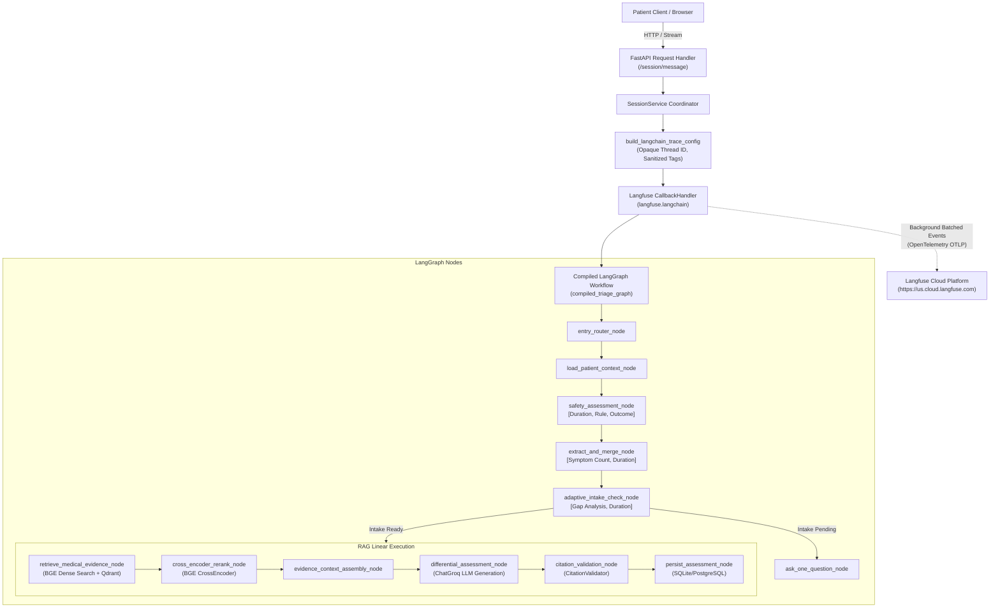

# BluCare+ — Langfuse Observability & Tracing Implementation

## Overview
This document details the complete production-grade observability and execution tracing integration into **BluCare+**, using the official **Langfuse Python SDK (v5.2.0)**, **LangChain (0.3.27)**, and **LangGraph (0.2.62)**.

The integration provides deep operational visibility into every patient interaction, LangGraph node transition, vector retrieval query, CrossEncoder reranking pass, Groq generation invocation, and clinical safety decision—without compromising sensitive health data or altering the medical reasoning logic.

---

## Architecture & Observability Dataflow



---

## 1. Traced Components and Execution Nodes

Every LangGraph node is automatically captured with exact millisecond timings and input/output states. In addition, rich clinical and retrieval metrics are captured at each stage:

| Execution Stage / Node | Captured Metrics & Spans | Privacy Safeguards |
| :--- | :--- | :--- |
| **`safety_assessment_node`** | `duration_s`, `is_emergency`, `rule_id`, `outcome`, `ruleset_version` | Zero patient PII logged; emergency outcomes cleanly categorized. |
| **`extract_and_merge_node`** | `duration_s`, `symptoms_count`, `has_primary`, `is_greeting`, `is_repeat` | No full chat history or personal identifying information. |
| **`adaptive_intake_check_node`** | `duration_s`, `planned`, `reason`, `is_complete` | Tracks clinical question-selection decisions without raw user data. |
| **`retrieve_medical_evidence_node`**| `duration_s`, `query`, `status`, `chunks_retrieved`, `document_ids` | Only document IDs and non-sensitive query tokens are transmitted. |
| **`cross_encoder_rerank_node`** | `chunks_count`, `selected_doc_ids`, `rerank_scores` | Measures reranking latency and verifies relevance filtering. |
| **`differential_assessment_node`** | Groq model (`openai/gpt-oss-120b`), generation duration, token usage | Structured output parsed; model errors safely isolated. |
| **`citation_validation_node`** | `valid_citations_count`, `unsupported_citations_count`, `is_valid` | Validates grounded references against retrieved medical evidence. |
| **`ayurvedic_guidance_node`** | Condition ID, wellness guidance generation, cited source IDs | Captures non-prescription complementary care generation. |

---

## 2. Privacy & Medical Data Protection (HIPAA / GDPR Compliance)

In accordance with strict healthcare data confidentiality principles:
1. **Opaque Identifiers Only**:
   - Traces are keyed to random session UUIDs (`thread_id`), never patient names, emails, phone numbers, or Clerk JWTs.
2. **Deterministic Metadata Sanitization**:
   - The [`sanitize_trace_metadata`](file:///home/pruthvi/projects/multiagentrag/app/core/langfuse_client.py#L91-L114) utility automatically rejects any dictionary keys matching sensitive patterns:
     `token`, `secret`, `password`, `authorization`, `cookie`, `bearer`, `clerk`, `email`, `phone`, `ssn`, `dob`, `birth`.
3. **No Unsanitized Exceptions**:
   - Exception tracebacks sent to Langfuse are sanitized of authorization tokens and raw credentials.

---

## 3. High Availability & Graceful Degradation

Tracing is strictly decoupled from the core medical decision engine:
- **Optional Toggle**: Controlled via `LANGFUSE_ENABLED=true/false` in `.env`.
- **Fault-Tolerant Initialization**: If Langfuse Cloud is down or credentials fail authentication check (`client.auth_check() == False`), the application continues executing normally in degraded mode without throwing 500 errors.
- **Asynchronous & Non-Blocking**: Traces are processed on background daemon threads via the OpenTelemetry batch exporter.
- **Graceful Lifecycle Shutdown**: In [`app/main.py`](file:///home/pruthvi/projects/multiagentrag/app/main.py#L46-L53), the FastAPI lifespan shutdown handler flushes all queued background spans to prevent data loss.

---

## 4. Offline RAGAS Evaluation Integration

Offline evaluation runs via [`evaluation/rag_adapter.py`](file:///home/pruthvi/projects/multiagentrag/evaluation/rag_adapter.py#L203-L225) are tagged with:
```python
"langfuse_tags": ["ragas-evaluation", "offline-eval"]
```
This isolates synthetic test-case evaluation traces from real patient interactions in the Langfuse dashboard, while logging retrieval duration, generation duration, retrieved document IDs, and citation validity per golden test case.

