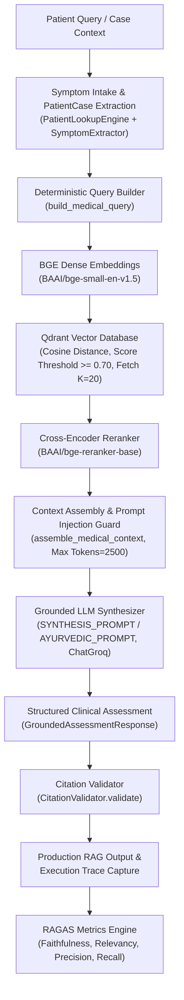

# BluCare+ — Complete RAGAS Evaluation Framework Architecture & Guide

## 1. System Architecture & Actual Execution Path

The BluCare+ evaluation framework benchmarks the **real, production clinical RAG pipeline** without shortcuts, synthetic mocks, or pipeline modifications.



### Production Components Evaluated
1. **Query Construction (`app/rag/query_builder.py`)**: Transforms patient symptoms, duration, severity, associated findings, and negations into a high-density clinical query.
2. **Dense Retrieval (`app/rag/retrieval_service.py` & `app/rag/store.py`)**: Uses normalized `BAAI/bge-small-en-v1.5` embeddings (384 dimensions) to search the `medical_triage_kb` collection in Qdrant with `score_threshold=0.70` and `fetch_k=20`.
3. **Cross-Encoder Reranking (`app/rag/store.py`)**: Re-scores candidate `(query, document_text)` pairs with `BAAI/bge-reranker-base` to surface the most relevant medical evidence.
4. **Context Construction (`app/rag/context_builder.py`)**: Assembles sanitized, bounded context chunks tagged with tokens `[S1]`, `[S2]`, and canonical document IDs.
5. **Grounded Synthesis (`app/rag/synthesizer.py`)**: Enforces strict evidence citation using structured Pydantic schemas (`GroundedAssessmentResponse` and `AyurvedicGuidanceResponse`).
6. **Citation Validation (`app/rag/citation_validator.py`)**: Validates that every citation token in the generated output corresponds to an actual retrieved document chunk.

---

## 2. Medical Golden Evaluation Dataset

The evaluation dataset is located at [`evaluation/datasets/medical_rag_golden.json`](file:///home/pruthvi/projects/multiagentrag/evaluation/datasets/medical_rag_golden.json) and contains **62 verified, clinically structured test cases** strictly derived from the 11 ingested medical guidelines:

### Corpus Documents Used as Ground Truth
| Document ID | Clinical Specialty | Title / Publisher |
| :--- | :--- | :--- |
| `MED-TENSION-HEADACHE-01` | Neurology / Headache | Tension-Type Headache Clinical Diagnosis & Home Care (WHO) |
| `MED-MIGRAINE-WITHOUT-AURA-02` | Neurology / Migraine | Clinical Diagnosis and Management of Acute Migraine (NICE CG150) |
| `MED-VIRAL-PHARYNGITIS-03` | Infectious Disease / URI | Acute Upper Respiratory Infection and Sore Throat Triage (CDC) |
| `MED-ACUTE-GASTROENTERITIS-04` | Gastroenterology | Clinical Assessment of Acute Diarrhea & Viral Gastroenteritis (WHO) |
| `MED-ACUTE-BRONCHITIS-05` | Pulmonology | Diagnosis & Supportive Treatment of Acute Cough / Bronchitis (NICE) |
| `MED-VIRAL-FEVER-06` | Infectious Disease | Acute Febrile Illness / Viral Fever Supportive Care (WHO) |
| `MED-DENGUE-FEVER-07` | Infectious Disease / Vector | Clinical Management of Dengue and Warning Signs Assessment (WHO) |
| `MED-INFLUENZA-08` | Infectious Disease / Flu | Seasonal Influenza Clinical Triage and Supportive Care (CDC) |
| `AYU-FEVER-JWARA-01` | Complementary / Ayurveda | Ayurvedic Clinical Guidance for Jwara / Febrile Illness (AYUSH) |
| `AYU-RESPIRATORY-KASA-02` | Complementary / Ayurveda | Ayurvedic Management of Upper Respiratory Distress / Kasa (AYUSH) |
| `AYU-HEADACHE-SHIRASHOOLA-03` | Complementary / Ayurveda | Ayurvedic Supportive Care for Tension Headache / Shirashoola (CCRAS) |

### Test Case Category Distribution (62 Cases)
- **Direct Medical Knowledge (11 cases)**: Specific queries testing core diagnostic facts and recommended supportive care.
- **Symptom Triage (16 cases)**: Patient symptom narratives, colloquial descriptions ("head in a vice grip"), and duration/severity triage.
- **Differential Diagnosis & Negative Findings (7 cases)**: Multi-document differential retrieval (e.g., tension headache vs. migraine, viral fever vs. dengue, bronchitis vs. pharyngitis).
- **Ayurvedic & Complementary Guidance (7 cases)**: Traditional diet (Langhana), herbs (Tulsi, Giloy, Ginger), and clinical contraindications (pregnancy, liver disease, gastric ulcers).
- **Out-of-Corpus & Insufficient Evidence (7 cases)**: Queries outside the triage corpus (Appendicitis, Diabetic Ketoacidosis, Lyme disease, Glaucoma, Kidney stones) testing abstention.
- **Emergency Safety Red Flags (14 cases)**: Life-threatening emergencies (thunderclap headache, pediatric stridor, severe dengue mucosal bleeding, cyanosis) verifying immediate clinical escalation.

---

## 3. RAGAS Metrics Implementation

The framework implements the four primary metrics via the official RAGAS 0.2.x API:

### 1. Faithfulness
$$\text{Faithfulness} = \frac{|\text{Supported Claims}|}{|\text{Total Generated Claims}|}$$
Measures whether claims in the generated assessment are supported by retrieved medical evidence. Essential for detecting hallucinated clinical statements or fabricated medications.

### 2. Answer Relevancy
$$\text{Answer Relevancy} = \frac{1}{N} \sum_{i=1}^N \cos(\mathbf{e}_{\text{gen}}, \mathbf{e}_{\text{orig}})$$
Measures whether the generated response directly addresses the patient's query without conversational filler or unnecessary tangents.

### 3. Context Precision
$$\text{Context Precision@K} = \frac{\sum_{k=1}^K (\text{Precision@k} \times \text{rel}_k)}{|\text{Relevant Documents in Top K}|}$$
Evaluates the ranking quality of the Cross-Encoder: verifies that target medical guidelines are ranked at position 1 or 2 rather than below non-matching documents.

### 4. Context Recall
$$\text{Context Recall} = \frac{|\text{Retrieved Ground Truth Claims}|}{|\text{Total Ground Truth Claims}|}$$
Measures whether the retrieval pipeline captured all necessary clinical evidence required to answer the medical query completely.

---

## 4. Evaluator Configuration & Safety Guardrails

- **Evaluator LLM**: Groq `openai/gpt-oss-120b` running in zero-temperature evaluation mode (`temperature=0.0`) wrapped in `ragas.llms.LangchainLLMWrapper`.
- **Evaluator Embeddings**: `BAAI/bge-small-en-v1.5` wrapped in `ragas.embeddings.LangchainEmbeddingsWrapper`.
- **Isolation Guarantee**: The evaluator never writes to live patient sessions, never touches user accounts, and operates completely offline from live chat traffic.
- **Abstention Verification**: Out-of-corpus queries with empty retrieval contexts are verified to ensure that the system does not invent guidelines or hallucinate treatments.

---

## 5. Execution & Verification

### Running the Evaluation Suite
```bash
# Execute full benchmark across all 62 test cases
./venv/bin/python -m evaluation.runner --experiment-name "blucare_baseline_v1"

# Execute a quick test run (e.g. 5 cases)
./venv/bin/python -m evaluation.runner --limit 5 --batch-size 5
```

### Running Automated Framework Tests
```bash
# Run pytest verification suite for evaluation framework
./venv/bin/pytest tests/test_evaluation_pipeline.py -q
```

